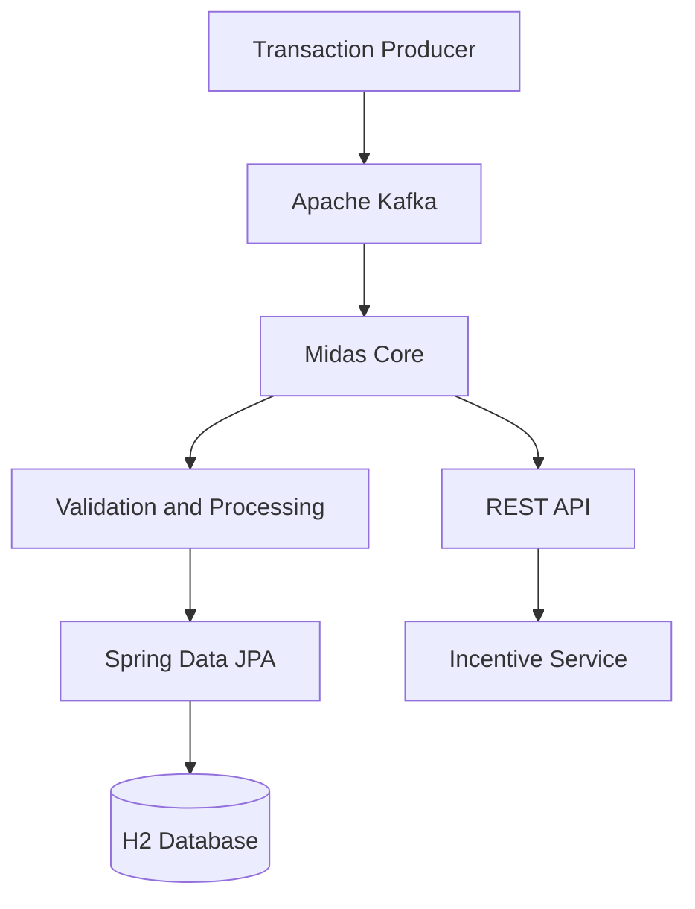

# 🏦 Midas Core
### JPMorgan Chase & Co. — Advanced Software Engineering Virtual Job Simulation

<p align="center">
  
  
  
  
</p>

**Midas Core** is a Java-based financial transaction processing project completed as part of the **JPMorgan Chase & Co. Advanced Software Engineering Virtual Job Simulation on Forage**.

The project explores the development of a backend system that receives financial transactions, validates and persists transaction data, and integrates with Kafka-based messaging and a REST API.

This repository documents my hands-on learning experience with Java backend development, Spring Boot, database persistence, event-driven architecture, and software testing.

---

## 📌 Table of Contents

- [Project Overview](#-project-overview)
- [Key Features and Concepts](#-key-features-and-concepts)
- [System Architecture](#-system-architecture)
- [Technology Stack](#-technology-stack)
- [Project Structure](#-project-structure)
- [Getting Started](#-getting-started)
- [Testing](#-testing)
- [What I Learned](#-what-i-learned)
- [Interview Revision Checklist](#-interview-revision-checklist)
- [Program Information](#-program-information)
- [Author](#-author)

---

## 🎯 Project Overview

Midas Core represents a backend financial transaction processing service. It brings together multiple components that are commonly used in enterprise Java applications.

The main areas explored in this project include:

- Consuming transaction messages through Apache Kafka.
- Representing transactions and related user data using Java objects.
- Persisting application data through Spring Data JPA.
- Working with a relational database using H2.
- Integrating application components through REST APIs.
- Writing and running tests to validate application behaviour.

The project is part of a **virtual job simulation**, designed to provide practical exposure to software engineering tasks and technologies used in professional development environments.

## ✨ Key Features and Concepts

- **Transaction Processing:** Work with incoming financial transaction data.
- **Event-Driven Communication:** Use Kafka concepts to exchange transaction messages between components.
- **Data Persistence:** Use JPA repositories and an H2 database for storing and retrieving application data.
- **REST API Integration:** Configure communication with an external incentive API.
- **Java Backend Development:** Organize application logic using Java and Spring Boot.
- **Automated Testing:** Use JUnit-based testing and Spring testing tools to validate implementation.
- **Maven Build Management:** Manage project dependencies, builds, and test execution.

*Note: These are the system's intended responsibilities and technologies; the exact behaviour available depends on the implemented code and configured services.*

## 🏗️ System Architecture

The following diagram illustrates the high-level transaction flow explored by the project.



### Component Responsibilities

| Component | Responsibility |
|---|---|
| Transaction Producer | Publishes transaction messages |
| Apache Kafka | Provides message-based communication |
| Midas Core | Processes incoming transaction data |
| Spring Data JPA | Supports database operations |
| H2 Database | Provides relational data storage |
| REST API | Enables communication with the incentive service |
| Automated Tests | Help verify expected application behaviour |

## 🛠️ Technology Stack

| Technology | Purpose |
|---|---|
| Java 17 | Primary programming language |
| Spring Boot 3.2.5 | Backend application framework |
| Spring Web | Web and REST functionality |
| Spring Data JPA | Database persistence and repository abstraction |
| Apache Kafka / Spring Kafka | Message-driven communication |
| H2 Database 2.2.224 | Runtime relational database |
| JUnit / Spring Boot Test | Automated testing |
| Testcontainers | Kafka integration-testing support |
| Maven | Dependency and build management |
| YAML | Application configuration |

## 📂 Project Structure

```text
forage-midas/
├── .mvn/
│   └── wrapper/
├── services/
├── src/
│   ├── main/
│   │   └── java/
│   │       └── com/jpmc/midascore/
│   └── test/
├── .gitignore
├── application.yml
├── mvnw
├── mvnw.cmd
├── pom.xml
└── README.md
```

The repository also contains application configuration and supporting source files. The exact files and packages may evolve as the implementation changes.

## 🚀 Getting Started

### Prerequisites

Install or configure the following:

- Java Development Kit (JDK) 17
- Git
- A terminal
- Apache Kafka and any other external services required by the application

Maven Wrapper scripts are included in the repository, so a separate Maven installation is generally unnecessary.

### 1. Clone the repository

```bash
git clone https://github.com/jagratimishra05/forage-midas.git
cd forage-midas
```

### 2. Verify Java

```bash
java -version
```

Confirm that Java 17 is available.

### 3. Build the project

On macOS or Linux:

```bash
./mvnw clean compile
```

On Windows:

```bash
mvnw.cmd clean compile
```

### 4. Run the tests

```bash
./mvnw test
```

### 5. Run the application

```bash
./mvnw spring-boot:run
```

**Configuration note:** The application uses Kafka-related settings and references an incentive API at `http://localhost:8080/incentive`. Ensure the required services are available and correctly configured before expecting the full transaction flow to work. A successful build does not by itself guarantee that every integration is running.

## 🧪 Testing

The project includes testing dependencies for Spring Boot, Spring Kafka, and Testcontainers.

Run the full test suite with:

```bash
./mvnw test
```

To investigate a failing test, check the Maven output for the failing test name, assertion, or application configuration error.

Integration tests involving Kafka may require a working container runtime or other test infrastructure, depending on how the tests are configured.

## 🧠 What I Learned

Working on this simulation helped me explore and practise:

- Building backend applications with Java and Spring Boot.
- Understanding the role of producers, consumers, and message brokers.
- Structuring Java applications into manageable components.
- Mapping Java objects to database records with JPA.
- Understanding REST API integration.
- Managing dependencies and build lifecycles with Maven.
- Using automated tests to check application behaviour.
- Debugging configuration, compilation, and integration issues.

These concepts are relevant to backend engineering, distributed systems, and financial technology applications.

## 🎓 Interview Revision Checklist

Use this section as a quick refresher before technical interviews.

- [ ] **Java:** OOP, interfaces, exceptions, collections, and generics.
- [ ] **Spring Boot:** Dependency injection, beans, application configuration, and auto-configuration.
- [ ] **REST APIs:** HTTP methods, status codes, request/response handling, and API integration.
- [ ] **Kafka:** Topics, producers, consumers, consumer groups, offsets, and message serialization.
- [ ] **JPA:** Entities, repositories, object-relational mapping, and persistence.
- [ ] **Databases:** SQL fundamentals, primary keys, transactions, and data consistency.
- [ ] **Testing:** Unit tests versus integration tests, assertions, and test isolation.
- [ ] **Maven:** Dependencies, lifecycle phases, `pom.xml`, and the Maven Wrapper.
- [ ] **System Design:** Message-driven processing, failure handling, retries, and idempotency.

**Interview tip:** Be prepared to explain not just what each technology does, but where it is used in this project, why it is useful, and what problems you encountered while implementing or testing it.

## 🏅 Program Information

- **Organization:** JPMorgan Chase & Co.
- **Platform:** Forage
- **Program:** Advanced Software Engineering Virtual Job Simulation
- **Project:** Midas Core
- **Repository:** [jagratimishra05/forage-midas](https://github.com/jagratimishra05/forage-midas)

This repository showcases practical work associated with a virtual job simulation. It should not be interpreted as evidence of employment or an internship directly with JPMorgan Chase & Co.

## 👩‍💻 Author

**Jagrati Mishra**

- GitHub: [@jagratimishra05](https://github.com/jagratimishra05)
- Project Repository: [forage-midas](https://github.com/jagratimishra05/forage-midas)

---

<p align="center">
  <i>Learning by building. Improving through debugging. Growing as a software engineer.</i>
</p>
